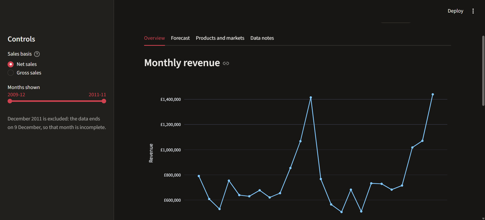
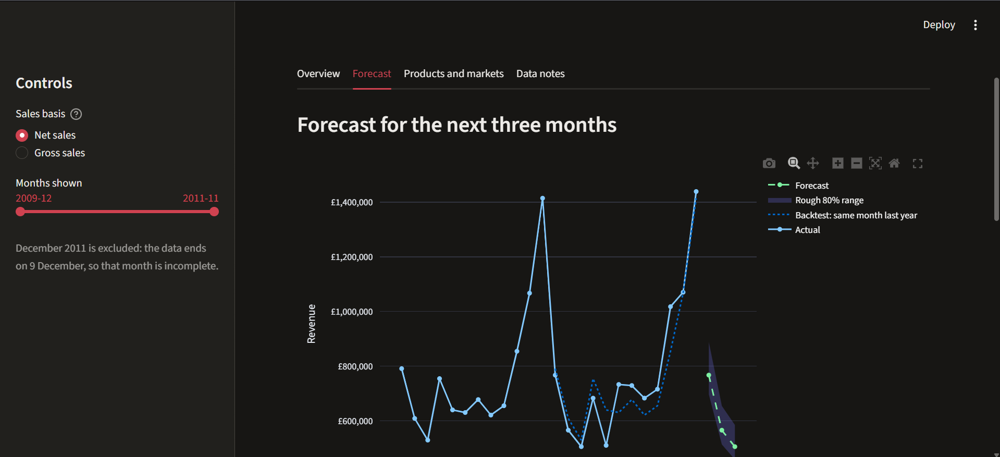

# E-commerce Analytics and Forecasting Dashboard

> A Python and SQL project that cleans two years of retail transactions, answers business questions in SQL, evaluates forecasting models with a leakage-free backtest, and presents the results in an interactive dashboard.

**Live dashboard:** [aacharo-retail-analytics.streamlit.app](https://aacharo-retail-analytics.streamlit.app/)
**Author:** [Anade A’Acharo](https://aachar-0.github.io/)

| Overview | Forecast |
|---|---|
|  |  |

## Contents

- [Business questions](#business-questions)
- [Key findings](#key-findings)
- [Forecasting results](#forecasting-results)
- [Method](#method)
- [Data](#data)
- [Tech stack](#tech-stack)
- [Project structure](#project-structure)
- [Run it locally](#run-it-locally)
- [Limitations](#limitations)
- [Privacy and ethics](#privacy-and-ethics)
- [Technical reference](#technical-reference)
- [License and attribution](#license-and-attribution)

## Business questions

1. Which products and markets generate the revenue?
2. How seasonal is demand, and when does it peak?
3. How much do cancelled orders distort the picture?
4. What can be said about the next three months, and how reliable is it?

## Key findings

- **Strong seasonality.** Revenue builds from September and peaks in November (net sales of about £1.41M in 2010 and £1.44M in 2011) before falling in December.
- **One dominant market.** The United Kingdom accounts for roughly 85% of revenue. EIRE, the Netherlands and Germany follow at 2% to 3% each.
- **Top products by net revenue.** Regency Cakestand 3 Tier (£322k), White Hanging Heart T-Light Holder (£253k) and Red Retrospot Jumbo Bag (£181k).
- **Cancellations are material.** 12% to 18% of invoices are cancelled every month, and cancelled lines were worth about 7% of valid sales value (£1.46M of £19.6M).
- **Cancelled orders can mislead.** An order of 80,995 units (£168k) would have ranked as the fourth best-selling product, but it was cancelled. A cancelled order of 74,215 units overstated January 2011 revenue by 15.7% (about £105k). The project therefore reports both **gross** and **net** sales.

## Forecasting results

Each model was tested on net sales with a rolling backtest: for each month from December 2010 to November 2011, the model saw only earlier months and predicted the next one (12 out-of-sample forecasts).

| Model | Average error (MAE) | RMSE | Average error (%) |
|---|---|---|---|
| **Same month last year** (seasonal naive) | **£63,357** | £78,024 | **9.0%** |
| Same month last year, scaled by growth | £75,191 | £88,602 | 9.5% |
| Repeat last month (naive) | £190,854 | £259,618 | 24.6% |

With only 24 months of history, reusing last year's pattern was the hardest to beat, and the growth adjustment did not help. The resulting three-month forecast follows last year's values:

| Month | Forecast | Rough 80% range |
|---|---|---|
| December 2011 | £767k | £696k to £887k |
| January 2012 | £565k | £513k to £654k |
| February 2012 | £505k | £458k to £584k |

The range comes from only 12 backtest errors, and the winning model was chosen on the same 12 months it is scored on, so these figures are indicative. December 2011 is a month the data covers only in part. The backtest can also be run on gross sales or with one outlier line removed (`--series gross`, `--series net_ex_outlier`).

## Method

| Stage | What happens | Code |
|---|---|---|
| Load | Read both sheets of the Excel file and combine them | `src/01_load_and_inspect.py` |
| Clean | Remove exact duplicates; flag cancellations, non-product codes and missing customers | `src/02_clean_data.py` |
| Store | Build a SQLite database with indexes and views | `src/03_build_database.py`, `sql/01_views.sql` |
| Analyse | Business questions in SQL: CTEs, window functions, conditional aggregation | `sql/02` to `sql/05` and `src/04_run_queries.py` |
| Forecast | Compare baselines with a rolling backtest | `src/forecasting.py`, `src/05_run_forecast.py` |
| Present | Export aggregates and serve them in Streamlit | `src/06_export_dashboard_data.py`, `app/streamlit_app.py` |

**Net sales.** A cancellation row carries no link to its original sale, so net sales remove lines matched on customer, product, quantity, unit price and date order. Each cancellation removes only the latest earlier sale that fits. The match is approximate, and guest checkouts cannot be matched.

## Data

**Source:** Online Retail II, UCI Machine Learning Repository, licensed [CC BY 4.0](https://creativecommons.org/licenses/by/4.0/).

Chen, D. (2012). *Online Retail II* [Dataset]. UCI Machine Learning Repository. https://doi.org/10.24432/C5CG6D

| Step | Rows |
|---|---|
| Transactions loaded | 1,067,371 |
| Exact duplicates removed (sheet overlap) | 34,335 |
| Rows kept | 1,033,036 |
| Cancellation rows (flagged) | 19,104 |
| Non-product rows (flagged) | 5,980 |
| Rows without a customer ID (flagged) | 235,151 |

The dashboard covers 972,506 net sale lines from December 2009 to November 2011, across 4,699 products and 43 countries. The raw file is not stored in this repository.

## Tech stack

Python 3.13 · pandas · SQLite and SQL · Streamlit · Plotly · pytest · Git and GitHub · Streamlit Community Cloud

## Project structure

```
ecommerce-analytics-dashboard
├── app/
│   ├── data/                  Eight small aggregated CSV files used by the dashboard
│   ├── requirements.txt       Runtime packages for deployment
│   └── streamlit_app.py       The dashboard
├── docs/
│   ├── screenshots/           Images used in this README
│   └── technical-reference/
│       └── python-sql-analytics-reference.md
├── sql/                       Views, business questions and data-quality checks
├── src/                       Pipeline scripts 01 to 06 and forecasting.py
├── tests/                     test_forecasting.py (11 tests)
├── CITATION.cff
├── LICENSE
├── pytest.ini
├── requirements.txt           Full development environment
└── README.md
```

## Run it locally

1. Clone the repository and create an environment:
   ```powershell
   git clone https://github.com/AAchar-0/ecommerce-analytics-dashboard.git
   cd ecommerce-analytics-dashboard
   python -m venv .venv
   .\.venv\Scripts\Activate.ps1
   pip install -r requirements.txt
   ```
2. Download `online_retail_II.xlsx` from the dataset link above into `data/raw/` (create the folders with `mkdir data\raw, data\processed`).
3. Run the pipeline in order:
   ```powershell
   python src/01_load_and_inspect.py
   python src/02_clean_data.py
   python src/03_build_database.py
   python src/04_run_queries.py
   python src/05_run_forecast.py
   python src/06_export_dashboard_data.py
   ```
4. Run the tests and start the dashboard:
   ```powershell
   pytest
   streamlit run app/streamlit_app.py
   ```

To view the dashboard only, step 2 and 3 are not needed: the files in `app/data/` are included.

## Limitations

- Only 24 months of history, so seasonal models cannot be estimated reliably and forecast ranges are indicative.
- December 2011 is incomplete and is excluded from monthly analysis.
- Net sales are an approximation: partial cancellations remain, and sales without a customer ID cannot be matched.
- One June 2011 line (60 items at £649.50, £38,970) has no cancellation in the data and is kept.
- The first month of data makes every customer look new, so new-customer counts are not reported.
- The data comes from a single UK gift retailer, so conclusions may not generalise.

## Privacy and ethics

Customer IDs in the source data are anonymous numbers. They are not published here, the dashboard files contain aggregates only, and no attempt is made to identify anyone.

## Technical reference

[Python and SQL analytics reference](docs/technical-reference/python-sql-analytics-reference.md): pandas and SQL patterns, data-quality methodology, forecasting evaluation, testing, deployment and common pitfalls.

## License and attribution

Released under the [MIT License](LICENSE). Reuse is welcome, and the license requires that the copyright notice stays with any copy or substantial portion of this work. Please credit it as:

> Anade A'Acharo, *E-commerce Analytics and Forecasting Dashboard*, https://github.com/AAchar-0/ecommerce-analytics-dashboard

GitHub's **Cite this repository** button (from `CITATION.cff`) gives ready-made citation formats. Presenting this work as your own, or removing the notice, is not permitted by the license. Anyone who reuses the analysis should also credit the dataset authors under CC BY 4.0, as cited above.
